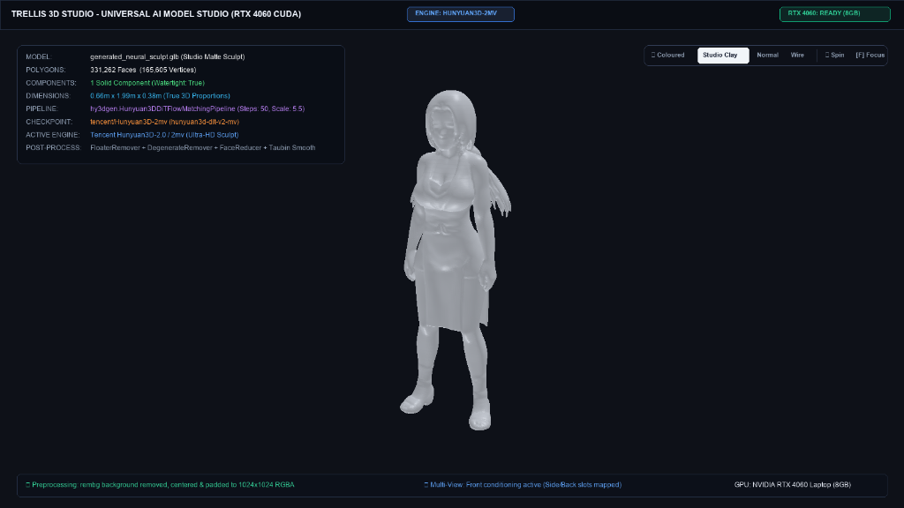
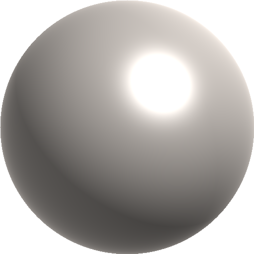
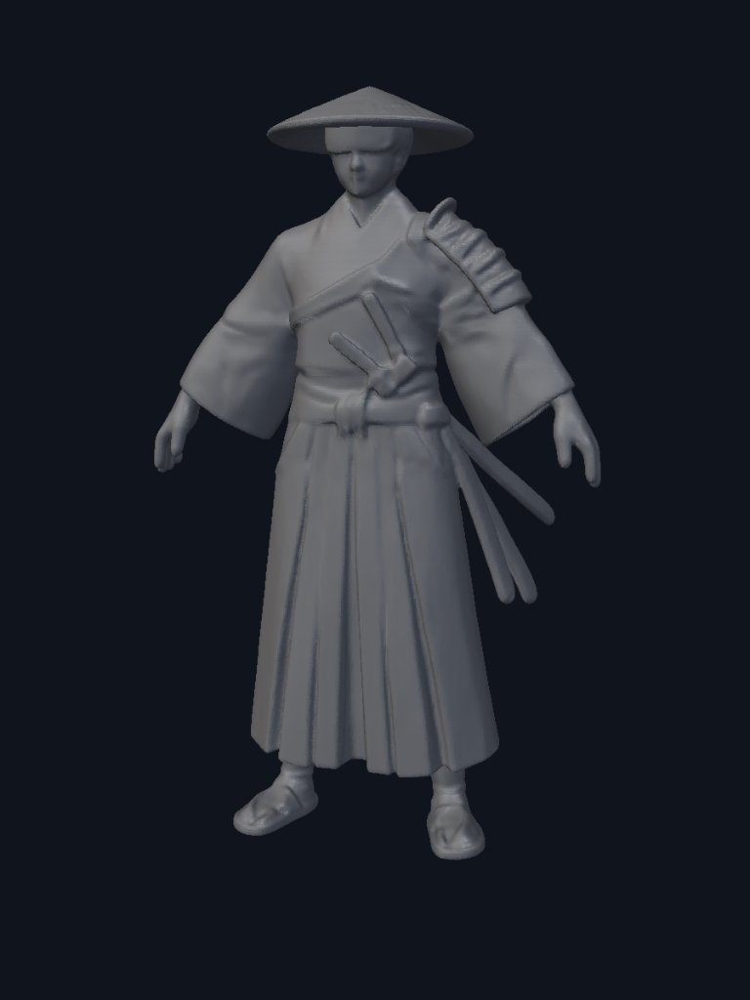
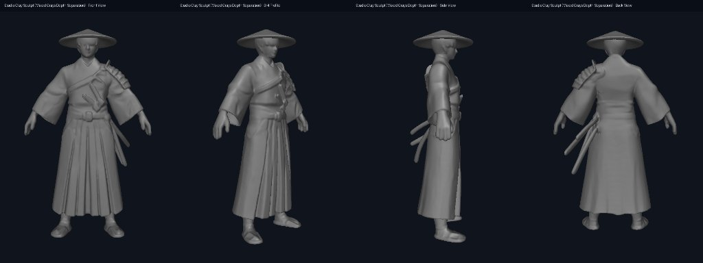

# TRELLIS 3D Studio - Universal AI Model Studio (RTX 4060 CUDA)

An AI-powered 3D character generation, anatomical neural sculpting, and modular rigging suite designed for local execution on NVIDIA RTX GPUs.



---

## Overview

**TRELLIS 3D Studio** bridges deep learning 3D reconstruction and game-ready character production. It allows creators to take 2D concept art and prompts, synthesize watertight high-poly neural meshes via Tencent Hunyuan3D-2/2mv and Microsoft TRELLIS, segment the character at natural anatomical joints, and preview them with studio-calibrated lighting and depth cavity shading.

---

## High-Contrast Studio Clay Shading

The viewport features a custom MatCap ambient occlusion shader calibrated for depth separation. Crevices, cloth folds, eyelid lines, and seams exhibit deep cavity occlusion, giving immediate clarity between anatomical volumes.

<p align="center">
  
</p>

- **Crevice Ambient Occlusion**: Concave recesses deepen to dark charcoal tones without flat clipping.
- **Anatomical Volume Midtones**: Neutral slate clay `#767a84` reveals muscle definition and fabric tension.
- **Controlled Matte Highlights**: Soft specular falloff strictly clamped below overexposure thresholds.

---

## Neural Character Sculpting & Anatomical Joints

Characters are generated as watertight solid manifold surfaces (over 300,000 polygons) and split at natural joints (neck, shoulders, elbows, waist, knees, and ankles) with boundary capping.

<p align="center">
  
  
</p>

---

## Sample Models Included

Pre-generated high-resolution sample models are provided in the `sample_models/` folder:

- `sample_models/samurai_modular_warrior.glb`: 14-part modular anime samurai with capped joints, straw kasa, sode armor, katana scabbards, and cavity ambient occlusion.
- `sample_models/anime_female_sculpt.glb`: High-poly female warrior character sculpt with clean facial topology and flowing hair.

---

## Quickstart

### 1. Launch the Desktop Studio
Run the global launcher:
```bat
Launch_TRELLIS_Studio.bat
```
or run directly via Python:
```bash
python desktop_studio_app.py
```

### 2. Controls & Modes
- **🎨 Coloured**: View genuine anime vertex and projected textures with balanced studio illumination.
- **Studio Clay**: High-contrast depth sculpt with crevice ambient occlusion.
- **🦴 Rig Skeleton**: Inspect anatomical joints and test forward kinematics (arm swings, knee bends, jump cycle).
- **💾 Save Model As...**: Prompt dialog to save rigged models with custom filenames (.GLB, .OBJ, .STL, .PLY).
